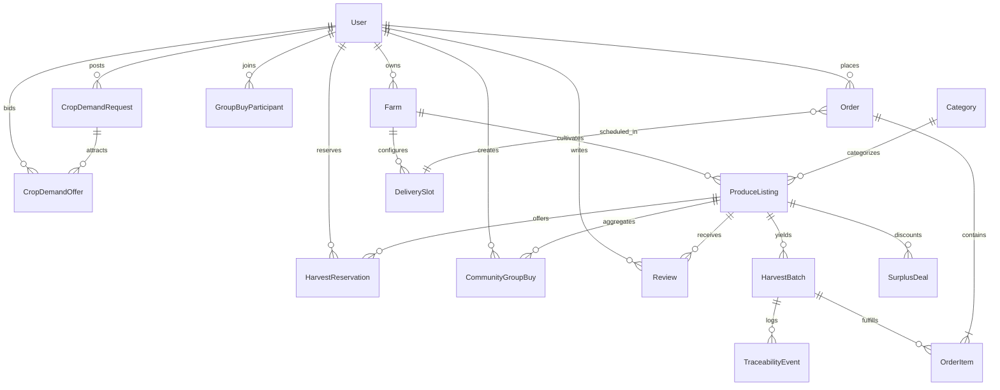

# 🌾 Harvest Hub — Smart Farm-to-Market Platform
### *Produce Traceability, Pre-Harvest Reservations & Surplus Rescue Engine*

[](https://openjdk.org/)
[](https://spring.io/projects/spring-boot)
[](https://spring.io/projects/spring-security)
[](https://react.dev/)
[](https://vitejs.dev/)
[](https://tailwindcss.com/)
[](https://www.postgresql.org/)
[](https://www.docker.com/)
[](http://localhost:8080/swagger-ui.html)

---

## 📌 1. Project Overview & Motivation

Traditional agricultural supply chains are plagued by multi-tiered middlemen, opaque farmgate pricing, post-harvest spoilage exceeding 30%, and a complete lack of provenance for health-conscious consumers. 

**Harvest Hub** is an enterprise-grade, direct-to-consumer and B2B agricultural platform engineered to:
1. **Eliminate Middlemen Exploitation:** Connect certified organic and regenerative farmers directly with urban households, restaurants, and wholesale bulk buyers.
2. **Guarantee Crop Traceability:** Implement a cryptographic **Harvest-to-Home Traceability Passport** with scannable QR codes detailing harvest timestamps, GPS farm origin, lab soil tests, and cold-chain temperature logs.
3. **Mitigate Pre-Harvest Uncertainty:** Enable **Pre-Harvest Advance Reservations**, allowing farmers to lock in guaranteed purchase contracts before plucking crops.
4. **Combat Food Waste:** Power a real-time **Surplus Rescue Engine** with countdown-driven dynamic discounts (up to 40% off) to rapidly clear expiring inventory.
5. **Democratize Wholesale Pricing:** Feature **Community Group Buying Pools**, aggregating neighborhood demand to unlock bulk farm discounts.
6. **Ensure Algorithmic Freshness Transparency:** Provide an **Explainable Freshness Indicator** calculating peak flavor windows with full mathematical transparency and food-safety disclaimers.

Designed and engineered for **College Final-Year Capstone Submissions**, **Production Portfolios**, and **Senior Full-Stack Engineering Interviews**.

---

## 🏛️ 2. Architectural Blueprint & Concurrency Control

```
                      +----------------------------------------------------+
                      |               React 18 + Vite Frontend             |
                      |  (Tailwind CSS, Lucide, QR Generator, Persona Bar) |
                      +-------------------------+--------------------------+
                                                |
                                      REST JSON | Bearer JWT
                                                v
                      +----------------------------------------------------+
                      |            Spring Boot 3.2.5 Backend               |
                      |   Spring Security 6.2 Filter Chain & JWT Provider  |
                      +-------------------------+--------------------------+
                                                |
        +-----------------------+---------------+-----------------------+
        |                       |                                       |
        v                       v                                       v
+---------------+       +---------------+                       +---------------+
| Order Service |       | Freshness     |                       | Traceability  |
| (Pessimistic  |       | Calculation   |                       | Passport      |
|  Write Lock)  |       | Service       |                       | Engine        |
+-------+-------+       +-------+-------+                       +-------+-------+
        |                       |                                       |
        +-----------------------+---------------+-----------------------+
                                                |
                                     Spring Data JPA / Hibernate
                                                |
                                                v
                      +----------------------------------------------------+
                      |        PostgreSQL 15 (Prod) / H2 In-Memory (Dev)   |
                      |   17 JPA Entities + Atomic DB Row-Level Locking    |
                      +----------------------------------------------------+
```

### 🔒 Concurrency Control: Zero Overselling via Pessimistic Write Locking

During flash surplus sales or community group-buy threshold closes, hundreds of buyers may attempt to purchase from a single limited `HarvestBatch` simultaneously. Relying on optimistic locking (`@Version`) would lead to a cascade of `OptimisticLockingFailureException` rollbacks, degrading user experience.

Harvest Hub implements **Pessimistic Write Locking** (`SELECT ... FOR UPDATE`) in `HarvestBatchRepository`:

```java
@Lock(LockModeType.PESSIMISTIC_WRITE)
@Query("SELECT b FROM HarvestBatch b WHERE b.id = :id")
Optional<HarvestBatch> findByIdWithLock(@Param("id") Long id);
```

Within `@Transactional(isolation = Isolation.REPEATABLE_READ)` in `OrderService.checkout()`:
1. The database row for the `HarvestBatch` is locked immediately when read by the checkout transaction.
2. Concurrent checkout threads wait until the lock is released.
3. Available quantity is checked against requested quantity:
   - If `batch.getQuantityAvailable() < requestedQuantity`, a structured `BadRequestException("Insufficient inventory available")` is thrown.
   - Otherwise, `batch.setQuantityAvailable(batch.getQuantityAvailable() - requestedQuantity)` updates the row, logs the line item, decrements delivery slot capacity, and commits atomically.
4. **Stock Rollback:** If an order is cancelled prior to shipment, inventory is refunded to the batch within a transaction.

---

## 🌟 3. Complete Feature Matrix

| Feature | Architectural Description | Key Technical Components |
|---|---|---|
| **🌾 Harvest-to-Home Traceability** | Digital provenance passport for each harvest batch. Features client-side QR generation, multi-stage timeline (Seeding, Harvesting, Cold Storage, Quality Testing, Dispatch), and role-based badges (Admin-Verified vs Farmer-Logged). | `TraceabilityPassport.jsx`, `TraceabilityController.java`, `TraceabilityService.java`, `qrcode.react` |
| **🌱 Harvest Reservations** | Advance booking marketplace for future harvests. Buyers pre-order crops at fixed rates, and farmers review and confirm yield availability with estimated delivery windows. | `HarvestReservations.jsx`, `ReservationService.java`, `ReservationStatus` lifecycle |
| **⚡ Surplus Food Rescue** | Real-time flash rescue deals offering 20%–40% discounts on surplus yields. Dynamic countdown timers, live stock meters, and a platform-wide **Kg of Food Rescued** impact counter. | `SurplusRescue.jsx`, `CountdownTimer.jsx`, `SurplusDealRepository.java`, `SurplusService.java` |
| **🤝 Community Bulk Buying** | Crowdsourced buying pools where community members pledge orders to meet a target threshold (e.g. 100 kg), unlocking tier-1 wholesale discounts. | `CommunityBuys.jsx`, `CommunityGroupBuy.java`, `GroupBuyParticipant.java`, `GroupBuyService.java` |
| **✨ Explainable Freshness** | Mathematical estimation of produce vitality based on harvest date, shelf-life half-life, and crop category windows. Transparent calculation breakdown modal with regulatory disclaimer. | `FreshnessBadge.jsx`, `ProduceService.java`, `ProduceResponse.java` |
| **📋 Crop Demand Board** | B2B & institution RFQ marketplace. Buyers post commercial crop requirements with target budgets; verified farmers submit competitive bids with price quotes and fulfillment terms. | `DemandBoard.jsx`, `CropDemandRequest.java`, `CropDemandOffer.java`, `DemandBoardService.java` |
| **🚚 Pickup & Delivery Slots** | Slot reservation engine with date/time pickers, cutoff hours, and strict capacity enforcement to prevent farm dispatch overload. | `Checkout.jsx`, `DeliverySlot.java`, `SlotService.java` |
| **⭐ Verified Purchase Reviews** | Anti-fraud review engine permitting reviews **only** if the authenticated buyer has a completed, delivered order containing that specific produce item. | `BuyerOrders.jsx`, `ReviewService.java`, `ReviewRepository.java` |

---

## 🗄️ 4. Database Schema & Entity Relationships

The data model comprises **17 JPA Entities** representing the full agricultural lifecycle:



---

## 🚀 5. Quickstart & Installation

Harvest Hub supports **two execution profiles**:
- **Profile A (Zero-Setup Dev Mode):** In-memory H2 database running in PostgreSQL compatibility mode with pre-seeded data. Requires only Java 17 and Node.js.
- **Profile B (Docker Compose Production Mode):** Full multi-container stack with PostgreSQL 15, Spring Boot backend container, and Nginx-powered React container.

### Prerequisites
- **Java JDK 17+** (`java -version`)
- **Maven 3.9+** (`mvn -v`)
- **Node.js 18+ & npm 9+** (`node -v`)
- **Docker & Docker Compose** (Optional, for containerized run)

---

### Option A: Local Development Setup (Recommended for Development)

#### 1. Start Backend (Terminal 1)
```bash
cd backend
mvn clean spring-boot:run
```
- Server boots at: `http://localhost:8080`
- Swagger UI Documentation: `http://localhost:8080/swagger-ui.html`
- OpenAPI JSON Spec: `http://localhost:8080/v3/api-docs`
- H2 Console: `http://localhost:8080/h2-console` (JDBC URL: `jdbc:h2:mem:harvesthub;MODE=PostgreSQL`)

#### 2. Start Frontend (Terminal 2)
```bash
cd frontend
npm install
npm run dev
```
- Vite client boots at: `http://localhost:5173`
- Pre-configured API proxy forwards `/api/*` requests to `http://localhost:8080`.

---

### Option B: Docker Compose (One-Command Production Stack)

Run the entire platform including persistent PostgreSQL 15:

```bash
docker compose up --build -d
```

| Service | Port | Description |
|---|---|---|
| **Frontend** | `http://localhost` (Port 80) | Nginx reverse proxy serving production React bundle |
| **Backend** | `http://localhost:8080` | Spring Boot REST API container |
| **PostgreSQL** | `localhost:5432` | PostgreSQL 15 database container (`harvesthub_db`) |

To stop the containers:
```bash
docker compose down -v
```

---

## 👥 6. Demo Personas & Instant Switcher

Harvest Hub includes pre-seeded accounts for instant evaluation. The application features an **Instant Demo Persona Switcher** dropdown in the top navigation bar, allowing you to seamlessly swap roles without logging out.

| Role | Email | Password | Details & Capabilities |
|---|---|---|---|
| **ADMIN** | `admin@harvesthub.farm` | `password123` | System oversight, farm verification approvals/rejections, platform revenue metrics. |
| **FARMER 1** | `farmer.green@harvesthub.farm` | `password123` | **Green Valley Organic Estate**. Manages organic strawberries, spinach, heirloom tomatoes, logs traceability stages, schedules slots. |
| **FARMER 2** | `farmer.sunshine@harvesthub.farm` | `password123` | **Sunshine Regenerative Orchards**. Manages honeycrisp apples, raw wildflower honey, submits bids on crop demand board. |
| **BUYER 1** | `buyer.shreya@harvesthub.farm` | `password123` | **Shreya Roy** (Household Buyer). Browses produce, places orders, reserves pre-harvest batches, joins bulk pools. |
| **BUYER 2** | `chef.arjun@harvesthub.farm` | `password123` | **Chef Arjun** (The Artisan Bistro). Posts bulk commercial demand tenders on the Crop Demand Board. |

---

## 📡 7. API Reference Overview

Comprehensive interactive documentation is available via Swagger UI at `http://localhost:8080/swagger-ui.html`.

### Key Endpoints

#### 🔐 Authentication & Profile (`/api/v1/auth`, `/api/v1/users`)
- `POST /api/v1/auth/register` — Register a new farmer or buyer account with role-specific fields.
- `POST /api/v1/auth/login` — Authenticate and receive a signed JWT token.
- `GET /api/v1/users/profile` — Retrieve current authenticated user profile.

#### 🛒 Marketplace & Produce (`/api/v1/produce`, `/api/v1/categories`)
- `GET /api/v1/produce` — Search and filter produce listings with multi-criteria query parameters (`search`, `categoryId`, `farmingMethod`, `maxPrice`, `organicOnly`).
- `GET /api/v1/produce/{id}` — Retrieve detailed produce specifications with active batches and explainable freshness score.
- `POST /api/v1/farmer/produce` — Farmer creates a new produce listing.
- `POST /api/v1/farmer/batches` — Farmer creates a new harvest batch.

#### 🔍 Digital Traceability Passport (`/api/v1/traceability`)
- `GET /api/v1/traceability/{batchCode}` — Public endpoint retrieving complete timeline events, farm location, lab results, and QR metadata for a harvest batch.
- `POST /api/v1/farmer/traceability` — Farmer logs an operational stage (`SEEDING`, `HARVESTING`, `COLD_STORAGE`, `PACKING`, `DISPATCH`).
- `PUT /api/v1/admin/traceability/{eventId}/verify` — Admin approves verification stamp on an audit event.

#### ⚡ Surplus Rescue & Flash Deals (`/api/v1/surplus`)
- `GET /api/v1/surplus` — Active surplus deals sorted by discount percentage and remaining countdown.
- `GET /api/v1/surplus/impact` — Aggregated platform metrics on total kilograms of food rescued from waste.
- `POST /api/v1/farmer/surplus` — Farmer marks a batch as surplus with discounted pricing and expiry countdown.

#### 🌱 Harvest Reservations (`/api/v1/reservations`)
- `GET /api/v1/reservations/upcoming` — Discover crops currently in cultivation open for pre-harvest booking.
- `POST /api/v1/reservations` — Buyer submits an advance pre-order reservation.
- `PUT /api/v1/farmer/reservations/{id}/confirm` — Farmer confirms reservation upon crop maturity.

#### 📦 Orders & Atomic Checkout (`/api/v1/orders`)
- `POST /api/v1/orders/checkout` — Atomic checkout with pessimistic row locking (`@Lock(LockModeType.PESSIMISTIC_WRITE)`).
- `GET /api/v1/orders/my-orders` — Buyer order tracking history with 5-stage progress visualizer.
- `PUT /api/v1/farmer/orders/{id}/status` — Farmer updates fulfillment status (`CONFIRMED` ➔ `PREPARING` ➔ `READY_FOR_PICKUP` ➔ `OUT_FOR_DELIVERY` ➔ `DELIVERED`).

#### 🤝 Community Bulk Buying (`/api/v1/group-buys`)
- `GET /api/v1/group-buys` — Active community bulk pools with progress bars toward target kg thresholds.
- `POST /api/v1/group-buys/{id}/join` — Buyer pledges order quantity toward the pool.
- `POST /api/v1/group-buys` — Community coordinator or farmer launches a new bulk buy pool.

#### 📋 Crop Demand Board (`/api/v1/demand-board`)
- `GET /api/v1/demand-board` — Active commercial RFQ requests from restaurants and bulk buyers.
- `POST /api/v1/demand-board` — Buyer creates an RFQ tender.
- `POST /api/v1/demand-board/{requestId}/offers` — Farmer submits a competitive price bid.
- `PUT /api/v1/demand-board/offers/{offerId}/accept` — Buyer accepts farmer quote.

---

## 🎓 8. College Project Defense & Viva Guide

### Slide Deck Presentation Outline (10 Slides)

1. **Title & Executive Summary:** Problem definition, middlemen exploitation, agricultural waste, and Harvest Hub's value proposition.
2. **System Architecture:** Clean 3-tier enterprise architecture (Spring Boot 3 + React 18 + PostgreSQL/H2).
3. **Pessimistic Concurrency Locking:** Explaining `@Lock(LockModeType.PESSIMISTIC_WRITE)` to eliminate race conditions and overselling during flash surplus events.
4. **Harvest-to-Home Traceability Engine:** Digital Passport, cryptographic QR codes, audit event logs, and administrative verification.
5. **Pre-Harvest Advance Reservations:** Hedging farm revenue risk via agricultural forward-booking contracts.
6. **Surplus Food Rescue & Dynamic Flash Deals:** Algorithmic countdown discounts and ESG food-waste analytics.
7. **Community Bulk Buying Engine:** Demand aggregation mechanics, pledge threshold tracking, and economies of scale.
8. **Explainable Freshness Algorithm:** Mathematical half-life decay modeling with consumer transparency and disclaimers.
9. **Security & Role-Based Access Control:** Stateless Spring Security 6 filter chain, JWT authentication, and role hierarchies (`ADMIN`, `FARMER`, `BUYER`).
10. **Live Demonstration & Future Roadmap:** Zero-setup startup, demo persona switcher, and mobile / IoT sensor expansion.

---

### Top 10 Technical Viva / Interview Questions & Answers

#### Q1: Why did you choose Pessimistic Write Locking (`PESSIMISTIC_WRITE`) over Optimistic Locking (`@Version`) for order checkout?
> **Answer:** In high-concurrency agricultural flash sales (such as Surplus Rescue with 40% discounts), dozens of buyers attempt to purchase the final 20 kilograms of a specific batch simultaneously. With optimistic locking, every concurrent transaction except the first will fail with an `OptimisticLockingFailureException`, causing poor user experience and high retry storms. Pessimistic write locking issues a database-level `SELECT ... FOR UPDATE`, queuing concurrent transactions and guaranteeing that stock decrement is strictly serialized and verified without race conditions or false failure cascades.

#### Q2: How does Harvest Hub prevent fraudulent or unverified customer reviews?
> **Answer:** Rather than allowing arbitrary reviews, `ReviewService.java` enforces a cryptographic business validation: when a user attempts to review a produce listing, the service queries `OrderRepository` for completed orders (`OrderStatus.DELIVERED`) belonging to that user that contain an `OrderItem` linked to that exact produce listing. If no delivered order exists, a `BadRequestException("Only verified buyers who completed an order can submit a review")` is returned.

#### Q3: How is JWT authentication handled statelessly in Spring Security 6?
> **Answer:** Harvest Hub uses a custom `JwtAuthFilter` extending `OncePerRequestFilter`. On incoming requests, the filter extracts the `Authorization: Bearer <token>` header, validates the HMAC-SHA256 signature using `JwtTokenProvider`, parses the user ID and role claims, loads the `UserPrincipal`, and populates the `SecurityContextHolder.getContext().setAuthentication(...)`. Sessions are explicitly configured as `SessionCreationPolicy.STATELESS` in `SecurityConfig`, ensuring horizontal scalability.

#### Q4: What is the mathematical basis of the Explainable Freshness Indicator?
> **Answer:** Freshness is calculated as:
> $$\text{Age in Days} = \text{ChronoUnit.DAYS.between}(\text{Harvest Date}, \text{Current Date})$$
> $$\text{Freshness Score} = \max\left(10, \ 100 - \left\lfloor \frac{\text{Age in Days} \times 100}{\text{Crop Freshness Window Days}} \right\rfloor \right)$$
> If $\text{Age} \le 20\%$ of the window, it is classified as `PEAK_FRESHNESS`; if $\le 50\%$, `HIGH_FRESHNESS`; if $\le 80\%$, `MODERATE_FRESHNESS`; otherwise, `RESCUE_CANDIDATE`. The frontend renders this alongside a transparent calculation breakdown modal and explicit agricultural disclaimer.

#### Q5: How do Community Group Buying pools work mechanically?
> **Answer:** A farmer or organizer creates a `CommunityGroupBuy` pool with a target quantity (e.g., 200 kg) and a deadline. As buyers join, their pledged quantities are accumulated atomically in `currentQuantity`. When `currentQuantity >= targetQuantity`, the pool status transitions from `OPEN` to `THRESHOLD_MET`, triggering wholesale discount rates for all participants and locking in shipping batches.

#### Q6: How does the application support both zero-config local development and production Docker deployment?
> **Answer:** Harvest Hub utilizes Spring profiles. By default, `application.yml` configures an in-memory H2 database running with `MODE=PostgreSQL`. When deployed via `docker compose`, the `docker` profile is activated (`SPRING_PROFILES_ACTIVE=docker`), causing Spring Boot to load `application-docker.yml` which connects to the PostgreSQL 15 container with persistent volume mounts.

#### Q7: How does Harvest Hub handle slot capacity limits for farm pickups and deliveries?
> **Answer:** Farmers configure `DeliverySlot` records with maximum order capacities (`maxOrders`) and cutoff lead times. During checkout, the selected slot's current booking count is checked against its capacity limit within the checkout transaction. If the slot is filled, the transaction rejects the checkout, prompting the buyer to select an alternate time window.

#### Q8: How does the Traceability QR Code verify authenticity?
> **Answer:** Each `HarvestBatch` has a globally unique batch code (e.g., `BATCH-2026-STR-01`). The frontend generates a client-side SVG QR code encoding the absolute URL `/traceability/{batchCode}`. When scanned by a smartphone or opened by any consumer, it accesses a public REST endpoint returning the verified audit chain with timestamps, GPS coordinates, lab test PDF links, and digital badges distinguishing farmer-submitted logs from admin-verified audits.

#### Q9: What happens to inventory if an order is cancelled?
> **Answer:** In `OrderService.updateOrderStatus()`, transitioning an order to `CANCELLED` triggers an inventory rollback. The service iterates over all `OrderItem` records in the order, fetches each associated `HarvestBatch` with a pessimistic lock, replenishes `quantityAvailable += item.getQuantity()`, and records an audit log entry.

#### Q10: How are Spring validation annotations leveraged across DTOs?
> **Answer:** All incoming request DTOs (`dto.request.*`) enforce strict bean validations using `@NotNull`, `@NotBlank`, `@Size`, `@DecimalMin`, and `@FutureOrPresent`. When validation fails, Spring Boot triggers `MethodArgumentNotValidException`, which is intercepted by `GlobalExceptionHandler` to return a standardized `400 Bad Request` payload with field-level error messages.

---

## 🧪 9. Automated Testing & Verification

The backend includes a comprehensive JUnit 5 and Mockito test suite testing critical workflows:

```bash
cd backend
mvn test
```

### Key Test Suites:
- `OrderServiceTest`:
  - `checkout_success()` — Verifies successful order checkout, subtotal calculation, and atomic batch stock deduction.
  - `checkout_insufficientInventory_throwsException()` — Verifies that attempting to purchase more than available stock raises `BadRequestException` and aborts the transaction.
- `AuthServiceTest`:
  - `register_success()` — Verifies successful password hashing (BCrypt), role assignment, and token issuance.
  - `register_duplicateEmail_throwsBadRequestException()` — Verifies rejection of duplicate email registrations.

---

## 📄 10. License

This project is licensed under the MIT License — open for academic submissions, commercial exploration, and portfolio demonstrations.
